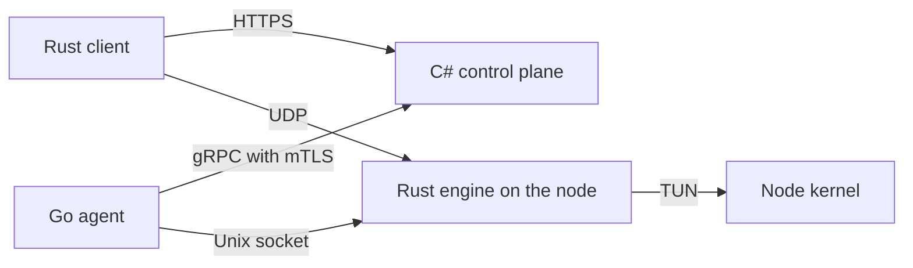

# VPN on Debian — Implementation Specification and Learning Roadmap

**Revision 3 · Reference environment: Debian 13 · Compatibility to verify: Debian 12**

## 1. Goal and deliverable

Build a Linux client, an exit node, and a central service that can establish and revoke VPN sessions. The project teaches network programming in Rust, service operations in Go, and API development and persistence in C#/.NET 10.

The MVP is complete when an authenticated user can connect two Debian clients, reach a test service through the node, check session status, and revoke one session while the other stays connected. The lab should make it possible to repeat the demonstration from clean machines and observe how the system behaves after failures.

The custom UDP transport is restricted to an isolated lab with test data. Deployments intended to carry real traffic must use the WireGuard backend and meet separate operational acceptance criteria. The Rust client and Go agent still configure and operate the tunnel in that profile. A web dashboard, quotas, roaming, and performance targets come after the MVP. The first release carries IPv4 traffic only.

## 2. Responsibilities and topology

| Component | Responsibility | Main skill |
|---|---|---|
| `engine-rust` / `vpn-engine` | Experimental engine on the node. Reads TUN packets, validates their source against the peer, and forwards traffic between TUN and UDP. Exposes controls and metrics over a Unix socket. | Ownership, buffers, error handling, and asynchronous I/O with Tokio. |
| `engine-rust` / `vpn-cli` | Authenticates over HTTPS, requests a session, configures the client tunnel, checks status, and restores configuration on exit. Shares the codec with the engine. | CLI design, state machines, and Linux integration. |
| `agent-go` / `vpn-agent` | Opens the gRPC channel to C#, configures networking on the node, applies commands through the backend, and reports results. Owns the node's VPN network rules. | Interfaces, contexts, timeouts, concurrency, and reconciliation. |
| `control-dotnet` / `vpn-control` | Handles authentication, authorization, node selection, IP address management (IPAM), session lifecycle, auditing, and telemetry. PostgreSQL stores the desired state. | ASP.NET Core, EF Core, transactions, and asynchronous services. |

Use a monorepo with `proto/`, `engine-rust/`, `agent-go/`, `control-dotnet/`, `deploy/debian/`, and `tests/e2e/`. Start with one ASP.NET Core project and one test project. Extract separate domain and data projects when the complexity warrants it. In Rust, start with binaries and a library in the same package. Pin the lab toolchain versions and document how to regenerate the Protobuf code.

## 3. Lab setup and bootstrap

- Set up two Debian client VMs and one Debian node VM on an isolated virtual network. Run the central service on another VM or on the development host, reachable over the management network. Put an HTTP test server on a separate network reachable from the node so you can verify forwarding without relying on the internet.
- Allocate one CIDR block per node. Keep VPN subnets, physical lab networks, and node allocations disjoint. For example, use `10.80.0.0/16` as the global pool, `10.80.1.0/24` for the first node, and `10.80.1.1` as its tunnel address. Reserve the network, broadcast, and gateway addresses.
- Run all three processes in the foreground for the first integration. Then move to dedicated service accounts. On the Rust/Go node, share the socket through a dedicated group, allow that group to traverse the directory, and set the socket mode to `0660`. Verify that a user outside the group cannot connect.
- Use a lab CA and a distinct identity for each node. The C# service maps the certificate to a registered node. Document credential issuance and rotation in the installation procedure. The client verifies the central service's HTTPS certificate. For the MVP, provision a test identity out of band and use short-lived tokens with session-level access control.
- Grant `CAP_NET_ADMIN` only for privileged network operations. Document which processes create the TUN interface, apply network rules, or need access to the interface. Limit packet captures and logs to test data.

## 4. Session lifecycle

1. The agent opens the mTLS stream, registers its identity, and reports the current `backend_instance_id`. The control plane reconciles the node before marking it eligible for new sessions.
2. The client calls `POST /v1/sessions` with an `Idempotency-Key`. With WireGuard, it sends its public key and keeps its private key locally. The control plane selects an eligible node and reserves an IP in a transaction that also stores the `pending` session and the pending command.
3. The control plane returns `202 Accepted` with the session ID and status URL. A dispatcher sends `ProvisionPeer`. The agent validates the command, applies it, verifies the backend state, and returns `CommandAck`.
4. A valid ACK moves the session to `active`. An authenticated status request returns the configuration needed to connect. Responses containing session material include `Cache-Control: no-store`. The client configures the interface and starts sending traffic. The `active` state means provisioning succeeded. The CLI reports connectivity based on an actual probe through the tunnel.
5. `DELETE /v1/sessions/{id}` starts revocation. The node removes the peer and acknowledges the change. The control plane releases the IP only after it confirms removal for the relevant peer and revision on the current backend instance. If the node is unavailable, revocation remains pending and the IP remains reserved. The node must enforce session expiration locally even when it loses contact with the control plane.
6. If provisioning partially succeeds, the control plane schedules cleanup and holds the reservation until it confirms the peer is absent. On reconnect, the system reconciles desired and applied state. Expired and revoked sessions are excluded from new peer lists.

Persist the following states: `pending`, `active`, `revoking`, `revoked`, and `failed`. Expiration moves a session to `revoking`. The `failed` state is terminal once cleanup is confirmed. Record the reason separately. Response timeouts leave commands pending for reconciliation. Reusing the same idempotency key for the same user and payload returns the original session ID. Reusing the key with a different payload returns `409`.

## 5. Integration contracts

| Boundary | Minimum contract |
|---|---|
| Control-plane REST API | `POST /v1/sessions`, `GET /v1/sessions/{id}`, `DELETE /v1/sessions/{id}`, `GET /v1/nodes` (admin), `GET /health/live`, and `GET /health/ready`. Only the session owner or an authorized administrator can read or revoke a session. |
| Go ↔ C# gRPC | `NodeChannel(stream AgentMessage) returns (stream ControlCommand)`. The agent sends `NodeRegister`, `NodeHeartbeat`, and `CommandAck`. The control plane sends `ProvisionPeer`, `RevokePeer`, or `SyncState`. |
| Go ↔ Rust Unix socket | `/run/vpn/engine.sock`. A big-endian `uint32` length prefix followed by UTF-8 JSON. Methods are `AddPeer`, `RemovePeer`, `SyncPeers`, and `GetMetrics`. |
| Node backend | A Go interface for applying and removing peers, reconciling state, and reading applied state. The lab backend calls the Rust socket. The WireGuard backend configures peers with system tools. |

**Identity and ordering.**

| Identifier | Lifetime and purpose |
|---|---|
| `stream_epoch` | Control-plane-issued identifier for one authenticated gRPC connection. A reconnect fences the previous stream and its acknowledgments. It does not reset packet counters. |
| `backend_instance_id` | Fresh identifier for one running data-plane instance, reported at registration and checked in commands and ACKs. A backend restart triggers reconciliation and invalidates lab keys bound to that instance. |
| `key_epoch` | Identifier for fresh directional keys and their send counters and receive windows. It changes on rekey or restart of either lab endpoint, independently of the control stream and desired revision. |

**Command delivery.** Include `command_id`, `node_id`, `stream_epoch`, `backend_instance_id`, desired `revision`, deadline, and payload. ACKs echo the identifiers and report the applied revision and outcome. Accept ACKs only from the current authenticated stream for the current backend instance and matching command. Apply at-least-once delivery idempotently and request a snapshot on a revision gap. A rejected or partially applied snapshot does not advance the applied revision or release leases. Reread applied state and reconcile before reporting success. Define the messages in `edge_orchestrator.proto` and reserve removed fields.

**Snapshot validation and deletion guard.** Read desired state and revision in one consistent database transaction. A read error aborts publication. Frame the raw serialized peer list with its byte length, declared peer count, and SHA-256 digest; verify all three against the received bytes and decoded list before mutation. Reject stale revisions, duplicate identities, invalid entries, and snapshots for a different node or backend. Treat accidental empty reads, truncated payloads, and invalid digests as errors, leaving the applied state intact.

Compute removals against the current applied set immediately before applying. Reject a snapshot if removals exceed 20% of current peers or if it would replace a nonempty set with an empty one. An exception requires authenticated, audited operator authorization bound to the node, backend instance, revision, and snapshot digest. A force flag bypasses only the deletion threshold, never validation. Serialize reconciliation per node and enforce the same guard for local `SyncPeers`. Reject and alert without issuing a success ACK. Explicit revocations and local expiration continue independently.

**Socket framing.** Handle one operation per connection in the MVP. Include a `request_id`, version, operation, and payload. The response echoes the ID and returns a status with either a result or an error code. Cap frames at 1 MiB, validate the length before allocating, and set read and write deadlines. Cap peers per node so the largest snapshot fits. Test fragmented reads, premature EOF, oversized frames, and unknown operations.

**Persistence.** Start with `nodes`, `sessions`, `ip_leases`, and `outbox`. Reserve IPs under a uniqueness constraint on the address, consistent with the disjoint pools. Store the session, lease, and command in one transaction. If two transactions compete for the last IP, one reserves it and the other receives an unavailable response. Use a UUID for the API session and a separate numeric ID for the lab protocol, unique among active sessions on the node.

## 6. Experimental Rust transport

For the first TUN ↔ UDP test, use one fixed peer inside the isolated network. Use `IFF_TUN | IFF_NO_PI`, a configurable inner MTU (default 1400), and explicit routes for lab IPs. For the protected transport, allocate reusable buffers at startup with 14 bytes of prefix headroom, inner-MTU bytes for the TUN payload, and 16 bytes of suffix tailroom. Read TUN directly into the payload region, write the header into the prefix, and pass the header as AAD to the detached in-place AEAD API. Write the tag immediately after the actual ciphertext and send the contiguous header, ciphertext, and tag via UDP. On receive, authenticate and decrypt in place, then write the payload slice to TUN. The application hot path must avoid intermediate vectors, per-packet heap allocations, and payload copies. Kernel I/O copies are outside this requirement.

| Offset | Size | Field |
|---:|---:|---|
| 0 | 1 byte | Version in the high nibble and type in the low nibble. |
| 1 | 1 byte | Reserved, zero in version 1. |
| 2 | 4 bytes | Node-local session ID, big-endian. |
| 6 | 8 bytes | Per-direction counter, big-endian. |
| 14 | Variable | Encrypted payload. |
| End minus 16 | 16 bytes | AEAD tag. |

The header is **14 bytes**, all used as AAD. Minimum outer overhead is **58 bytes for IPv4** or **78 bytes for IPv6**, before IP options, extension headers, or additional encapsulation. A 1400-byte inner MTU produces 1458-byte IPv4 or 1478-byte IPv6 outer packets and fits both a 1500-byte path and a 1492-byte PPPoE path with those base headers. Set the configurable inner MTU to at most the effective outer path MTU minus the applicable overhead, sizing for both directions. Phase 1 raw UDP omits the 14-byte header and 16-byte tag. Outer IPv6 accounting applies when that underlay is supported. Inner traffic remains IPv4 in the MVP.

- Version 1 message types are `DATA` (inner IPv4) and `KEEPALIVE` (empty payload). Use the control plane to revoke or end sessions.
- Use an existing ChaCha20-Poly1305 library with separate keys per direction. Form the 96-bit nonce from four zero bytes followed by the 64-bit counter. **Never repeat a key/nonce pair.** Allocate counters uniquely per direction even under concurrency, consume a counter once used for encryption, and rekey before wraparound.
- Use a 2048-packet replay window per receive key. Before AEAD, reject counters already seen or older than the window without mutating it. Only after successful tag verification, atomically recheck and mark the counter or advance the window so concurrent duplicates cannot both pass. Unauthenticated packets cannot advance the window. Validate IPv4 structure and check the assigned inner source IP before injecting into TUN.
- Require fresh directional keys and a new `key_epoch` after a restart of either lab endpoint or any loss of send-counter or replay state. Block traffic until reprovisioning completes. Use a new wire session ID for a new key epoch and retire the previous mapping. A stream reconnect alone preserves live keys and counters. `SyncPeers` carries instance-bound key references for already provisioned keys and must neither carry raw keys nor reset live counter or replay state. Reject unresolved references and use explicit provisioning with fresh keys on a new backend instance. Keep key material out of logs.
- With WireGuard, associate each peer's public key with its virtual IP. The control plane determines session authorization and duration. WireGuard handles its own transport keys.

## 7. Networking, deployment, and diagnostics

- Start with a split tunnel and route only the test network through it. For the full-tunnel profile, preserve a route to the UDP endpoint and access to the control API. Decide how to handle IPv6 and DNS before installing a default route. For an IPv4-only profile, verify that IPv6 traffic outside the tunnel is blocked while full tunneling is active.
- The agent enables forwarding and applies specific forward rules and NAT scoped to the node's IP pool and configured egress interface. Block client-to-client traffic by default in the MVP environment. Restrict changes to agent-owned rules. Validate syntax and apply updates transactionally without flushing the entire firewall.
- The client tracks the network objects it changes and restores routes and DNS on exit. Test recovery after abrupt process termination and ensure that one instance cannot remove another instance's objects. Require TCP MSS clamping on the node for forwarded SYN and SYN-ACK packets in both tunnel directions. Cap advertised MSS at the configured inner MTU minus 40 bytes for inner IPv4 (1360 with MTU 1400), preserving lower values. Test a large TCP transfer with ICMP fragmentation-needed messages filtered. Validate UDP sizing separately because MSS clamping applies only to TCP.
- Deliver systemd units, a sample configuration with no secrets, database migrations, and an installation, upgrade, and rollback runbook. Use structured logs with `node_id`, `session_id`, and `command_id`. Expose byte counters, active peer counts, backend failures, and time since the last heartbeat.
- When a tunnel carries no traffic, check the active session and matching ACK, the client route, UDP and TUN counters, node forwarding, and the return path, in that order. Measure recovery and throughput in the lab before setting targets.

## 8. Implementation and learning roadmap

| Milestone | What to build in order | What you can demonstrate | What you should be able to explain |
|---|---|---|---|
| 0 · Foundation | Set up the monorepo, pin toolchain versions, and add a build and a minimal test in each language. | `cargo test`, `go test ./...`, and `dotnet test` pass from a clean checkout. | Which binary runs on each machine and why. |
| 1 · Telemetry | Rust counts UDP bytes and exposes `GetMetrics`. Go reads the metric with a deadline. C# receives a local HTTP heartbeat and lists nodes from memory. | A 5-byte datagram increases the counter by five. Stopping the engine changes the observed state, and restarting it restores metrics collection. | Buffer ownership in Rust, cancellation in Go, and the lifetime of an injected dependency in C#. |
| 2 · TUN | Add the Rust interface, test routes, and forwarding for one peer. | Ping works both ways between virtual IPs, and packet captures show traffic on the expected interface. | The difference between an inner IP packet and an outer UDP datagram. |
| 3 · Control plane | Add PostgreSQL, IPAM, session states, and an outbox in C#. Replace Go's HTTP heartbeat with gRPC over mTLS and apply commands to a test backend. | Two concurrent requests for the last IP produce one reservation. Resending an applied command leaves the same state. | What the database transaction protects and what requires acknowledgment across processes. |
| 4 · End-to-end session | Integrate the encrypted Rust backend, CLI, peer operations, local expiration, and reconciliation. | Two clients can reach the test service. The engine drops tampered packets, replays, and packets with invalid source IPs. Revoking one client leaves the other connected. | AAD, counters, state after a crash, and when an IP can be released. |
| 5 · Deployment and recovery | Automate Debian installation and test process restarts, stream loss, and network restoration. | Installation is repeatable. Engine restart requires a new session. Revocation takes effect after reconnect, and route changes roll back. | Which process owns each setting and how to trace failures. |
| 6 · WireGuard | Implement the agent backend and client configuration. Verify split tunneling. Address DNS and IPv6 before enabling full tunneling. | Repeat provisioning, traffic forwarding, and revocation with WireGuard on two machines. Verify that the client's private key stays local. | Which responsibilities belong to your code and which WireGuard handles. |

**Execution status.** The table above is the planned order; the actual
execution diverged once, by explicit request, and the milestone identifiers
are preserved rather than renumbered:

- **2 · TUN — delivered out of order (verified).** The raw IPv4 TUN ↔ UDP
  forwarding loop (`vpn-engine`, PR #4) was implemented and lab-verified
  ahead of milestone 1: ping works both ways between virtual IPs on Debian
  12 and 13, with packet captures on the expected interfaces. Within the
  milestone, IPv4 forwarding, NAT, TCP MSS clamping, split/full-tunnel
  selection, route restoration, and the HTTP-through-the-node check remain
  deferred to the full-tunnel phase (recorded in `.agc/IMPLEMENTATION.md`).
- **1 · Telemetry — implemented on `feat/telemetry` (PR #6), merge
  pending.** The engine counts datagrams and answers `GetMetrics` on a
  Unix socket, the Go agent fetches them with a deadline, and the C#
  control plane records loopback-only heartbeats; the local gate observes
  the 5-byte increment, the outage, and the recovery. Integration into
  `main` awaits the PR #6 merge — not yet delivered there.
- **0 · Foundation — partially exercised.** The monorepo layout and the
  Rust, Go, and C# toolchains are in use; `proto/` and PostgreSQL remain
  placeholders until the control-plane milestone.
- **3–6 — pending**, with dependencies: control plane and sessions build on
  telemetry plumbing and the engine's control socket; full tunneling and
  the HTTP check depend on the deferred forwarding/NAT work above.

### First implementation session

1. **Rust.** Make the UDP receiver listen on loopback and accumulate `rx_bytes`. Send a datagram of known size. Then expose `GetMetrics` over the Unix socket. Exercise — explain why a single socket read can return only part of a frame, and write a test that reproduces it.
2. **Go.** Implement `FetchMetrics(ctx)` and decode the engine response. Exercise — simulate a socket that accepts the connection and then stays silent. Confirm that the deadline stops the read and the next collection still runs.
3. **C#.** Implement `POST /internal/heartbeats` on the local interface and `GET /v1/nodes`. Track `lastSeen` and engine health separately. Exercise — simulate a missing heartbeat and an engine failure, then compare the results. Remove the HTTP heartbeat once the gRPC stream is in place.
4. **Integration.** Run all three processes and record the 5-byte increment, outage, and recovery in a commit. For each milestone, write the acceptance criterion before coding, implement the smallest observable change, and reproduce one failure before closing the milestone.

## 9. Final MVP acceptance checklist

- [ ] A clean checkout builds and tests all three languages using reproducible instructions.
- [ ] The control plane rejects a stream with an invalid node identity. Users cannot access sessions owned by other users.
- [ ] Two clients connect through the CLI and reach the private test service. The service sees their traffic arrive through the node.
- [ ] Repeated requests and commands preserve the expected state. A lost ACK followed by reconnection converges to the expected revision.
- [ ] Revocation and expiration remove access. The control plane reuses the IP only after the node confirms removal. The other client stays connected.
- [ ] Restarting either lab endpoint forces fresh directional keys. Stale key references and packets from retired epochs are rejected. A control-stream reconnect preserves live counters.
- [ ] Reordered packets inside the 2048-packet window pass once. Stale packets and duplicates are rejected. An invalid tag with a high counter leaves the window unchanged.
- [ ] Database errors, truncated snapshots, checksum/count mismatches, and unauthorized mass removals preserve the applied peer set. An authorized force applies only to its validated snapshot.
- [ ] The protected Rust packet path reuses the same buffers without intermediate allocations or payload copies. MTU boundary packets and bidirectional TCP MSS clamping pass lab checks.
- [ ] Disconnect and recovery procedures restore client network objects. Logs trace the flow without exposing credentials.

## References

- [Linux kernel TUN/TAP documentation](https://kernel.org/doc/html/latest/networking/tuntap.html)
- [RFC 8439, ChaCha20 and Poly1305](https://www.rfc-editor.org/rfc/rfc8439.html)
- [WireGuard protocol and cryptography](https://www.wireguard.com/protocol/)
- [RFC 6479, anti-replay window algorithm](https://www.rfc-editor.org/rfc/rfc6479.html)
- [RFC 6691, TCP MSS](https://www.rfc-editor.org/rfc/rfc6691.html)
- [RFC 2516, PPPoE](https://www.rfc-editor.org/rfc/rfc2516.html)
